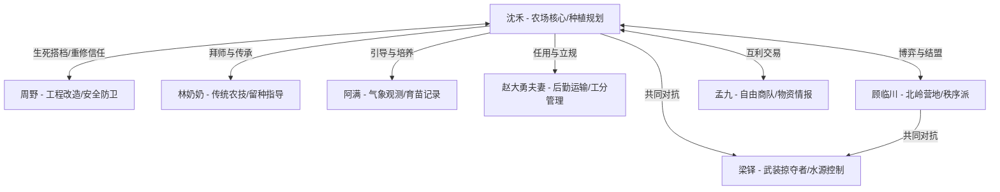

# 《重生之我在末世种田》人物设定集

> 配套大纲文档：[重生之我在末世种田_大纲与世界观.md](./重生之我在末世种田_大纲与世界观.md)

---

## 一、核心主角

### 1. 沈禾（女主）

- **年龄**：重生时 24 岁（前世死于 34 岁）
- **身份**：灾变前为农林院校毕业生、家庭园艺工作室主理人；灾变后为旧苗圃农场创建者与负责人
- **能力专长**：
  - 无战斗异能，拥有极强的**土壤识别、育苗留种、堆肥改良、病虫害防治与温室控温**经验
  - 熟悉粮食晾晒、窖藏、腌制、发酵等长效储藏方式
  - 后期具备农场排班、口粮核算与多聚居点资源协调能力
- **外貌特征**：常年扎低马尾，肤色偏小麦色，虎口和指腹有常年握农具留下的薄茧；穿耐磨的多口袋工装，随身带一把折叠嫁接刀和防水记录本
- **性格特点**：
  - 务实、冷静、极度惜粮，对“浪费种子和干净水”零容忍
  - 不圣母也不冷血，讲究“等价交换、按劳取酬、底线兜底”
  - 习惯把最坏结果提前算清，做决定时果断，不轻易把后背交给别人
- **前世经历**：
  - 灾变初期因没有防备失去亲人，辗转多个幸存者营地做农场杂工和仓库管理员
  - 第十年在一次粮仓暴乱中，为了抢救最后一批抗灰化稻种，被同伴锁在起火的副仓中身亡
- **人物弧光**：
  - **第一阶段（自保）**：只想囤好种子、守住一亩三分地，不愿接纳外人
  - **第二阶段（立规）**：在扩建农场的过程中发现“独善其身”无法抵御天灾与人祸，开始建立劳动与分配规则
  - **第三阶段（传承）**：从守着一座农场，走向推动多点种植与种子共享，真正成为末世农业秩序的建立者
- **标志性台词**：
  > “枪能抢来一顿饭，但只有地里长出来的东西，才能让人活过明年冬天。”

---

### 2. 周野（男主）

- **年龄**：重生时 26 岁
- **身份**：灾变前为农机与给排水设备维修师；灾变后负责农场的机械改装、净水循环、围栏加固与外勤防卫
- **能力专长**：
  - 精通柴油机、光伏板、雨水过滤系统、滴灌管网与温室通风设备改造
  - 具备极强的野外路线规划、陷阱布置与近身防卫能力
- **外貌特征**：身形高挑精悍，短发利落，左眉骨有一道细小旧疤；常戴半指劳保手套，工具袋从不离身
- **性格特点**：
  - 话少、克制、执行力极强，习惯先动手解决问题再开口解释
  - 风险意识极高，看问题比沈禾更悲观，但在沈禾做出决定后会无条件兜底执行
- **前世羁绊与心结**：
  - 前世曾与沈禾在同一个流亡车队同行，在一次外来武装夺粮混战中，他为了带走重伤的幼弟和急救药，未能折返救出被困的沈禾
  - 重生后他带着强烈的愧疚找到沈禾，不求立刻被原谅，只用一次次修好水渠、守住夜哨来弥补
- **人物弧光**：
  - 从“被负罪感驱使的赎罪者”，成长为能与沈禾坦诚分担生死抉择、共同守望土地的伴侣
- **标志性台词**：
  > “你只管算下一季种什么。只要我还站着，水不会断，温室的棚顶也不会塌。”

---

## 二、农场核心成员

### 3. 林秀英（林奶奶）

- **年龄**：65 岁
- **身份**：退休基层农技推广员、老种子守护者
- **能力专长**：
  - 熟知本地老品种作物习性、土法防虫、草木灰配比与传统选种留种技术
  - 在没有现代化肥和农药的条件下，能凭经验判断土壤酸碱度与作物病兆
- **性格特点**：
  - 表面严厉嘴硬，实则心怀悲悯；最看不得年轻人糟蹋秧苗
  - 看透人情冷暖，是农场里的“定海神针”和精神长辈
- **剧情作用**：
  - 弥补沈禾在传统农艺与地方老品种上的知识空白
  - 在农场出现内讧时，以长者威望帮沈禾稳住人心；后期将毕生农技经验整理成册传给年轻人

---

### 4. 阿满（陈满）

- **年龄**：13 岁
- **身份**：灾变后流落到苗圃附近的孤儿，后成为农场育苗助手与气象记录员
- **能力专长**：
  - 对风向、云层、湿度变化和虫鸣异常极其敏锐
  - 记忆力好，能熟记几十块试验田的播种日期、发芽率与需水量
- **性格特点**：
  - 早期像一只护食的小兽，警惕、敏感、习惯藏干粮
  - 被沈禾接纳并赋予“记录员”职责后，逐渐变得有归属感与责任心
- **人物弧光**：
  - 从“为了半块饼干偷翻篱笆的流浪儿”，成长为能独当一面预测灰潮与霜冻的新一代农人，象征末世里新希望的延续

---

### 5. 赵大勇 & 许翠芬（农场骨干夫妻）

- **年龄**：38 岁 / 36 岁
- **身份**：原本在城郊跑货运的夫妻，灾变初期带着一辆改装厢式货车投奔农场
- **角色定位与特点**：
  - **赵大勇**：力气大、会开重卡和挖掘机，负责开荒翻地与大宗物资运输；脾气直，讲义气
  - **许翠芬**：精明能干、擅长管账与后勤炊事，负责农场食堂配给与工分登记
- **剧情作用**：
  - 代表普通幸存者家庭：他们会有私心、会害怕亏本，但在看到沈禾公正的规矩和稳定的产出后，成为最坚定的规则维护者

---

## 三、外部势力与重要配角

### 6. 顾临川

- **年龄**：32 岁
- **身份**：邻近大型幸存者据点“北岭营地”最高负责人（前应急救援队指挥骨干）
- **核心立场**：**秩序优先、集中配给**
- **性格与手段**：
  - 冷静、铁腕、极具组织力，认为末世里只有绝对集权和统一调配才能让大多数人活下来
  - 并非残暴掠夺者，但为了营地几百人的口粮，会毫不犹豫向沈禾施压、封锁道路甚至试图强行收编农场
- **与主角的关系**：
  - 从第三卷的“收编与反收编对手”，到第四卷旱季危机中的“有限盟友”，最终在第五卷承认沈禾的分布式农场模式，达成平等监督协议

---

### 7. 孟九（九姐）

- **年龄**：29 岁
- **身份**：游走于各个聚居点之间的自由商队首领
- **能力专长**：掌握跨区域交通路线、二手农机零件、药品与稀缺矿物盐渠道
- **性格特点**：
  - 八面玲珑、唯利是图却极守契约精神，信奉“杀了种地的人，明年大家都得饿死”
- **剧情作用**：
  - 帮沈禾打破顾临川的早期封锁，建立“以粮换药、以种换铁”的交易网络，也是外部世界情报的主要来源

---

### 8. 梁铎（主要反派之一）

- **年龄**：35 岁
- **身份**：外来掠夺型武装“灰狼团”头目
- **核心立场**：**弱肉强食、以战养战**
- **性格与作用**：
  - 拒绝任何长期生产，靠控制上游水源和抢劫成熟农田逼迫周边聚居点进贡
  - 在第三卷末至第四卷引发水源危机，促使沈禾、顾临川与周边散户放下分歧结成联盟

---

## 四、人物关系表

---

## 五、群像设计原则（写作备忘）

1. **去金手指化**：没有无限空间和灵泉，所有人的本事都来自前世经验、专业技能与试错积累。
2. **利益与人性并存**：配角不是单纯的工具人，每个人投奔农场都有具体的生存诉求（求口粮、求药品、求庇护）。
3. **冲突围绕“土地与规矩”展开**：人物之间的靠近或决裂，都通过“如何对待种子、如何分配粮食、在危机中保谁”来体现。
